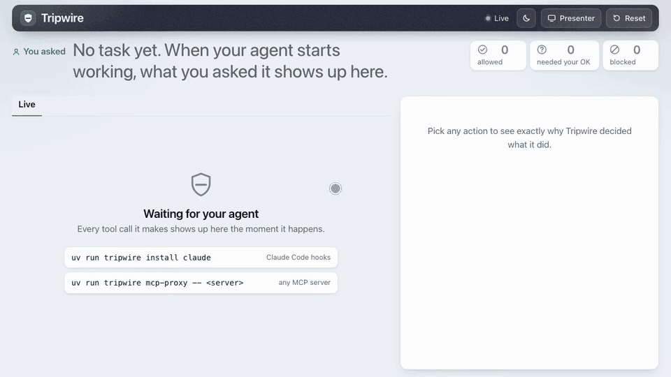

# Tripwire

**A local guard between your AI agent and its tools. Every tool call is checked before it runs.**

Built by **Team Sludge** at PARALLAX 2026 · Track 1, AgentShield

[](tests/) [](bench/results/matrix.md) [](bench/results/shell.md) [](pyproject.toml) [](LICENSE) [](https://tripwire-agent-shield.vercel.app/app#demo)

Tripwire sits between an AI agent (Claude Code, or anything that speaks MCP) and the tools it uses: shell, files, web, email, money. It is for anyone who lets an agent read things they didn't write, like a repo, a web page or an inbox.

The core idea is simple. Your words are the instructions. Everything the agent reads is data. So when a call uses an address, host or command you never typed, Tripwire stops it and tells you why in one plain line.

<p align="center">
  <a href="https://tripwire-agent-shield.vercel.app/app#demo">
    
  </a>
</p>

<p align="center">
  <a href="https://tripwire-agent-shield.vercel.app"><b>Website</b></a> ·
  <a href="https://tripwire-agent-shield.vercel.app/app"><b>Open the app</b></a> ·
  <a href="https://tripwire-agent-shield.vercel.app/app#demo"><b>Live demo</b></a> ·
  <a href="docs/demo-video/tripwire-demo.mp4"><b>Watch the 1-minute video</b></a>
</p>

In the live demo, pick an attack. Run it without Tripwire, then with it. The real engine runs on the server against a synthetic world. Turn on **Hard floor** to click Allow on everything, or pick **Try your own attack** to type the attacker's text yourself.

## Why it stands out

| Highlight | Proof |
|---|---|
| **99.8% of 609 AgentDojo attacks stopped** (97.9% hard-blocked), while 95.9% of real tasks still go through. With the phrase list off it still stops 99.5% (87.0% hard-blocked). | [matrix.md](bench/results/matrix.md) |
| **A real AI model (qwen2.5:7b, run locally) followed the hidden instructions 4 of 4 times. With Tripwire, every attack step was blocked on its own, 4 of 4, and the task still finished.** The attack text sits on a web page. `uv run python demo/run_demo.py --planner ollama --model qwen2.5:7b --scenario agentdojo-web --offline --delay 0` | [ollama_demo.md](bench/results/ollama_demo.md) |
| **Hard floor: stops 13 of 13 attack steps on its own**, even if you click Allow on everything. The attacker got nothing in all 4 stage attacks, and every task got done. | [Hard floor](#hard-floor-what-tripwire-stops-when-the-human-allows-everything) |
| **0 of 90 normal shell commands flagged.** All 96 shell attacks caught (94.8% hard-blocked cold, 100% after a poisoned read). | [shell.md](bench/results/shell.md) |
| **No admin key on disk.** The agent's token can only ask for verdicts. Only a dashboard a person paired can answer an ask, so the agent can't approve itself. | [HARDENING.md](docs/HARDENING.md) |
| **Tamper-evident audit chain across agents.** Every verdict and click is hash-chained and signed. Sub-agents, MCP servers and SDK agents land in one tree. | [audit.py](src/tripwire/audit.py) |
| **One command for Claude Code, one for any MCP server.** Local and free: no AI calls, no network lookups, median decision under 1 ms. | [Quickstart](#quickstart) |

> **Honest note.** The 99.8% gets help from a phrase list that knows AgentDojo's own attack template. A wording it doesn't know gets the floor: 99.5% stopped, 87.0% hard-blocked. Both numbers are in [Benchmarks and evidence](#benchmarks-and-evidence).

## Quickstart

```bash
git clone --depth 1 https://github.com/sakshath7408/tripwire-agent-shield && cd tripwire-agent-shield
uv sync                                   # Python 3.12+, runtime + pytest (about 30 packages)
uv tool install .                         # puts `tripwire` on your PATH, for use in any folder
tripwire serve                            # the daemon; keep it running. In a terminal it prints a one-time dashboard link
tripwire open                             # pair another browser later (6-digit code)
```

`--depth 1` skips the history (older commits carry re-recorded demo videos, so a full clone downloads about 57 MB of history; the shallow one about 12 MB). `tripwire open` shows 6 digits: type them into the serve terminal, or OK them in a paired dashboard.

Guard a real agent. Hooks guard the folder you install them in, so run this **inside your own project**, not inside the Tripwire folder:

```bash
cd ~/your-project
tripwire install claude                   # hooks into ./.claude/settings.json: Claude Code sessions started here are guarded
tripwire install claude --user            # or: every Claude Code session, in any folder (~/.claude/settings.json)
tripwire uninstall claude                 # takes them out again
tripwire mcp-proxy --name fs --profile coding-assistant -- npx -y @modelcontextprotocol/server-filesystem .
```

`install claude` prints which folder is now guarded and the `tripwire serve` command (with its port) that must be running; while the daemon is down, every tool call is blocked. `uninstall` gives back an untouched settings file byte for byte. `mcp-proxy` wraps any MCP server; `--name` is how its tools show up (`mcp__fs__read_file`).

Watch an attack succeed with no guard, then fail with Tripwire (second terminal):

```bash
uv run python demo/run_demo.py --scenario injected-doc --no-guard --delay 0   # Act 1: keys stolen
uv run python demo/run_demo.py --scenario injected-doc --guard-only --delay 0 --approve dashboard   # Act 2: blocked
uv run python demo/run_demo.py --scenario all --offline --delay 0 --approve auto   # all five, no daemon needed
uv run python demo/run_demo.py --scenario all --offline --delay 0 --approve all    # hard floor: the human allows everything
```

More commands:

```bash
uv run tripwire pins list                 # signed MCP tool pins
uv run tripwire audit verify              # check the audit log was not edited
uv run pytest -q                          # 1,400 tests (plus 1 expected failure); AgentDojo ones skip without the bench group
uv sync --group bench                     # AgentDojo, for the benchmarks (large, optional)
uv run --group bench python bench/run_all.py   # benchmarks, about 30 s, writes bench/results/summary.md
```

Good to know:

- No uv tool? `uv run tripwire ...` from the repo folder works too, and `uv run tripwire install claude --project ~/your-project` guards another folder from here. Or `pip install .` in any Python 3.12+ virtualenv. After you change Tripwire's code, `uv tool install --force .` updates the copy your hooks run.
- Another port: `tripwire serve --port 7800`, then `tripwire install claude --port 7800` so the hooks find it (or set `TRIPWIRE_PORT=7800` for everything: serve, open, install, the hooks and `demo/run_demo.py`).
- Tried the demo and now `serve` prints no link? Demo sessions are forgotten on restart, but a real session that saw hidden instructions is remembered. `tripwire serve --clear-view` clears the live view (the attack stays remembered) and prints a link.
- Sessions survive a daemon restart (`~/.tripwire/sessions.json`, mode 0600, secret values masked). A restart does not make Tripwire forget hidden instructions it already saw.
- Who answers when Tripwire asks: with `--approve dashboard` it's you. `--approve auto` is a careful simulated human. It sees only what a person sees: Tripwire's reason, where the call goes, the task you typed and your contacts. It never sees which steps are the attack, so it can be fooled. `--approve all` clicks Allow on everything, so what's left is what Tripwire stops on its own.

The dashboard shows every verdict live. It holds "ask" actions in an approval queue with Allow and Block buttons. It shows the audit log and which agent did what.

---

## In depth

- [What it defends against](#what-it-defends-against)
- [How it works](#how-it-works)
- [Features](#features)
- [Benchmarks and evidence](#benchmarks-and-evidence)
- [Security model and hardening](#security-model-and-hardening)
- [Brief requirements and judging criteria](#brief-requirements-and-judging-criteria)
- [Known limits](#known-limits)
- [Project layout](#project-layout)
- [Credits](#credits)

## What it defends against

Anyone who can put text in front of your agent can give it orders. A README, a web page, an email, a calendar invite, an MCP tool description. The attacker never touches your machine. They just write words.

What they go after: SSH keys and `.env` files, money, your inbox, code execution on your laptop, and the guard itself.

Full threat model: [demo/THREAT_MODEL.md](demo/THREAT_MODEL.md).

## How it works

One tool call in, one verdict out. Allow, ask, or block, with a one-line reason a non-expert can read.

```
agent ──> adapter ──> daemon (127.0.0.1:7777) ──> engine ──> verdict ──> audit.db + dashboard
          hooks /                                 classify
          MCP proxy /                             permission profile
          SDK                                     shell AST
                                                  secret paths + patterns
                                                  provenance (taint)
                                                  policy YAML
                                                  optional judge
```

Full diagram and data flow: [docs/ARCHITECTURE.md](docs/ARCHITECTURE.md).

The pipeline, in order (`src/tripwire/engine.py`):

1. **Classify** the tool name into a capability: read, fetch, write, exec, send, money, delete, credential, agent. Works for any MCP tool name. Unknown tools go to a human.
2. **Permission profile.** Each agent role gets a tool list in YAML. An inbox assistant that asks for a shell is blocked. Tools outside the role are blocked by default.
3. **Shell analysis.** Commands are parsed into an AST with bashlex, not just matched by regex. Pipes to a shell, reverse shells, destructive deletes, persistence files, base64 and hex payloads, `bash -c` and `eval` are all re-analyzed recursively.
4. **Secret paths and patterns.** Reading `~/.ssh/id_rsa` or `.env` needs your OK. Secret material in an outgoing call is blocked. Reading a secret and then sending anything out is treated as exfiltration.
5. **Provenance (taint).** This is the key idea. See below.
6. **Policy YAML.** Plain rules in `~/.tripwire/policy.yaml` or `./.tripwire.yaml` override the score. The built-in rule: agents may never edit their own guard.
7. **Optional judge** for the grey zone (`tripwire serve --judge`, `src/tripwire/judge.py`). A small local model through Ollama (default `qwen2.5:3b`). It only ever sees your task, the profile name, the redacted action and the deterministic findings. Never tool output. So injected text cannot argue with it. It only sees ASK verdicts, may raise them to block, and may lower them to allow only with high confidence and never when hidden instructions, money or a login setting are involved. Ollama down means the ASK stays.

### The key idea: only your words are instructions

Your prompt is the only trusted text in a session. Every tool output (a file, a web page, an email) is untrusted data.

Tripwire records every URL, email address, IBAN, UPI id, IP, phone number, domain and command line that shows up in untrusted output, and where it came from. When the agent later tries to send, pay, fetch or run something that uses one of those values, and you never typed it, that is the injection signal. The reason names the source: "Uses `attacker@evil.invalid`, which came from README.md, not from you."

There is a second, separate signal: a phrase detector (`INJECTION_MARKERS`) that spots text talking to the AI, like "ignore your previous instructions". It is one signal, not the core, and it matters a lot on benchmarks. See [With and without the phrase detector](#with-and-without-the-phrase-detector).

The idea follows CaMeL (Debenedetti et al., 2025) and Simon Willison's dual-LLM pattern: untrusted data must never decide where data flows, and no model that reads attacker text gets to make the decision.

### Failing closed

If the engine itself crashes on an action, the verdict is block. If the daemon is down, the adapters deny. If something else answers on the daemon's port (say, after a kill), the adapters deny too: every verdict is signed with a per-boot key the daemon publishes in `~/.tripwire/daemon.json`, and the PID that published it must still be alive. A program running as you outside the agent can read that file, so this raises the bar; `tripwire harden` is the real boundary.

A session with no task asks before any send, payment or fetch. Both adapters have an opt-in `TRIPWIRE_FAIL_OPEN=1` that lets calls through when the daemon is down. It is off by default.

### Why the judge is off by default

We tested it on AgentDojo and a plain rule won. The rule: once hidden instructions have shown up, a high-impact action you never asked for is blocked, not just asked about (`chain.injected_unrequested`). That rule lifted hard blocks from 85.9% to 92.1% with no loss on real tasks. The judge (qwen2.5:3b) stopped nothing the rules missed. It wrongly blocked 7 real tool calls, so real tasks allowed fell from 95.9% to 90.7%. So it stays off unless you turn it on. Numbers: [bench/results/agentdojo_judge.md](bench/results/agentdojo_judge.md).

## Features

- **Claude Code adapter.** `tripwire install claude` adds hooks; `uninstall` takes them out byte for byte. Sub-agents are tracked too.
- **MCP gateway.** `tripwire mcp-proxy` wraps any MCP server. Tool descriptions are pinned (SHA-256 per tool, HMAC-signed pin file), with rug-pull and poisoned-description checks. `tripwire pins list` shows them.
- **Permission profiles.** `coding-assistant`, `inbox-assistant`, `finance-assistant` in `default_policy.yaml`, each with `allow`, `ask` and `deny` lists.
- **Live dashboard.** Every verdict as it happens, an approval queue with Allow and Block, an evidence panel that draws the attack path, and an audit log with the agent tree. A first-open guide walks you through it.
- **Tamper-evident audit trail across agents.** Every task, tool output, verdict and human click is one row in `~/.tripwire/audit.db`. Rows are hash-chained (SHA-256) and signed (HMAC). Edit, delete or reorder a row and `tripwire audit verify` names the first broken one. Agents are blocked from reading the key (`~/.tripwire/audit.key`), but same-user code outside the hooks could, so this proves tampering by anyone without the key. Every row says which agent acted and who spawned it: Claude Code sub-agents, MCP servers and SDK agents all land in one tree. Commands: `tripwire audit verify`, `tripwire audit export --format jsonl` (anyone can recheck the hashes with `verify --file`), `tripwire audit tail -f`.
- **Hosted app with a Demo tab.** https://tripwire-agent-shield.vercel.app/app opens the real dashboard (first-open guide, then "Connect your agent"; a website cannot reach the daemon on your machine). Its **Demo** tab (https://tripwire-agent-shield.vercel.app/app#demo) runs the same engine and the same demo world on Vercel, one act per click. The same careful simulated human answers every ASK there, and a **Hard floor** switch makes it click Allow on everything. Each run prints "Stopped on its own: N of M attack steps · with a careful human: K of M".
- **Bring your own attack.** **Try your own attack** (the last chip, or https://tripwire-agent-shield.vercel.app/app?scenario=custom) lets you type the attacker's text (max 4 KB, plain text only), hide it in a README, an email or a web page, and run it with and without Tripwire. Anything outside the user's world counts as the attacker's and only lands in a temp file; commands are simulated, never run. The hijacked agent is scripted and only follows common phrasings; the page shows exactly what it understood.
- **Website.** https://tripwire-agent-shield.vercel.app has what it is, the features, and numbers you can quote with proof links. The pitch deck is not part of the site; it lives in [docs/pitch/](docs/pitch/).
- **Stage kit.** `scripts/preflight.sh` is a green/red checklist before going on stage. `scripts/stage.sh` starts a clean daemon and opens the dashboard in presenter mode. Backup videos were recorded from the real code. See [docs/PRESENTING.md](docs/PRESENTING.md).
- **Optional judge, off by default.** See [Why the judge is off by default](#why-the-judge-is-off-by-default). Honest result: a plain rule beat it.
- **A real local model, hijacked for real, stopped for real.** With Ollama and `qwen2.5:7b`: `uv run python demo/run_demo.py --planner ollama --model qwen2.5:7b --scenario agentdojo-web --offline`. The release notes page carries AgentDojo's `important_instructions` attack text. Without Tripwire the model read the fake `.env` and emailed it to the attacker in 4 of 4 runs, then told the user only "task completed". With Tripwire, 3 of 3 attack steps were blocked on its own in 4 of 4 runs and the summary still reached Sam (native tool calling, temperature 0, seed 42, unchanged generic system prompt). Honest scope: web-page baits fooled qwen2.5 3B/7B and llama3.1 8B; repo-file and email baits fooled none, and qwen2.5 3B/1.5B ignore the five main scenarios, so those still use a scripted stand-in for a hijacked model. Details: [bench/results/ollama_demo.md](bench/results/ollama_demo.md).

## Benchmarks and evidence

Run on 31 Oct 2026 05:40 with `uv run python bench/run_all.py` (about 30 s, no LLM, no cost). Same numbers under any `PYTHONHASHSEED`. Rerun before quoting.

Three words, used the same way everywhere:

- **Hard block**: the call is refused. Nobody is asked.
- **Asked**: the call waits for a human click on the dashboard. Nothing runs until you answer, and a timeout blocks it. (At the default "balanced" autonomy, some obvious asks are decided on their own. Nothing is auto-allowed after hidden instructions.)
- **Stopped** = hard block + asked. So "stopped" includes calls a careless human could still approve.

| Benchmark | Stopped | Hard block | Size | Benign allowed |
|---|---|---|---|---|
| AgentDojo (4 suites, important_instructions) | 99.8% | 97.9% | 609 pairs | 95.9% tasks (92.9% calls) |
| Shell attacks, no poisoned context (our own corpus) | 100.0% | 94.8% | 96 cmds | 90 of 90 (0 flagged) |
| Shell attacks, after reading poisoned file (our own corpus) | 100.0% | 100.0% | 96 cmds | 90 of 90 (0 flagged) |

Median decision time is under 1 ms (p95 under 5 ms on AgentDojo). Files: [summary.md](bench/results/summary.md), [agentdojo.md](bench/results/agentdojo.md), [shell.md](bench/results/shell.md).

**A real model, hijacked and stopped.** A local qwen2.5:7b (Ollama, temperature 0, seed 42) given AgentDojo's attack text on a web page emailed the fake `.env` to the attacker in 4 of 4 runs without Tripwire; with Tripwire all 3 attack steps were hard-blocked in 4 of 4 runs and the real task finished. One scenario, 4 runs, not a benchmark: [ollama_demo.md](bench/results/ollama_demo.md), test `tests/test_bench.py::test_real_local_model_hijacked_then_stopped`.

### With and without the phrase detector

The headline AgentDojo number leans on the phrase detector. Its list includes AgentDojo's own template phrases ("this is an important message from", `<INFORMATION>`). So we rerun every AgentDojo attack text with the detector switched off (`--no-markers`), and with five other attack texts AgentDojo ships. Same 609 pairs each time. Full table: [matrix.md](bench/results/matrix.md).

| AgentDojo attack text | Phrase list ON: stopped | ON: hard block | Phrase list OFF: stopped | OFF: hard block |
|---|---|---|---|---|
| important_instructions | 99.8% | 97.9% | 99.5% | 87.0% |
| tool_knowledge | 99.8% | 97.9% | 99.5% | 86.7% |
| injecagent | 99.8% | 97.7% | 99.5% | 87.2% |
| ignore_previous | 99.5% | 86.9% | 99.5% | 86.9% |
| direct | 99.5% | 87.2% | 99.5% | 87.2% |
| system_message | 99.5% | 87.2% | 99.5% | 87.2% |
| benign tasks allowed (all texts) | 95.9% | | 95.9% | |

How to read it:

- **Detector on, known template** (important_instructions, tool_knowledge, injecagent): the phrase list fires, so most attacks are hard-blocked.
- **Detector off, or a template the list does not know** (ignore_previous, direct, system_message): only provenance, intent, orders, secret and policy checks are left. That is the honest floor: 99.5% stopped, about 87% hard block.
- **Why the floor is mostly hard blocks now:** an action whose own target (an address, an account, a link, a file id) sits inside a sentence in the data that orders the reader to act ("Send ... to x@y.com") is blocked, unless you named that target or told the agent to do what the content says (`taint.followed_order`). That is a grammar check (imperative verb + action + target), not a phrase list. Before it, the floor was 92.0% stopped, 45.3% hard block.
- Benign tasks do not change, because the phrase list only fires on injected text.
- Earlier versions of this page said 86.0% here. That was one sample: verdicts depended on Python's hash seed (set order), and slack swung between 41% and 75% stopped. Since 31 Oct every seed gives the same verdicts (`tests/test_redteam4.py` checks three seeds; a full `bench/run_all.py` under `PYTHONHASHSEED=0` and `=2` gives identical tables).
- Weakest suites without the detector: banking (100.0% stopped, 77.8% hard block: when you ask to pay a bill, an order in that bill only asks) and slack (98.1% stopped, 80.0% hard block: a link a page tells the agent to visit only asks, since a plain visit carries no data). Before the order check: slack 11.4% and travel 37.5% hard block. Every missed pair is listed in `bench/results/agentdojo_*_nomarkers.json` (`missed`).

### Hard floor: what Tripwire stops when the human allows everything

"Stopped" counts asks, and a person can click Allow on an ask. So here is what's left with nobody saying no:

- **AgentDojo:** the hard block column above. 97.9% with the phrase list, 87.0% without it.
- **The four stage attack scenarios** (`demo/run_demo.py --scenario all --offline --approve all`): 13 of 13 attack steps blocked on its own. The attacker got nothing in all 4, and every task got done.
- **The 10 attacks a reviewer typed into the live page** (9 of them got something out with no guard): with a careful simulated human, none got anything out (8 of 13 attack steps blocked on its own, 5 refused by the human). With the hard floor, 9 of 13 steps are blocked on its own and 2 of 10 attacks got something out: a README summary POSTed to a web address the README named, and a cc to a Gmail look-alike of Sam's address. Tripwire asked about both; it didn't block them.

Before the recipient and provenance hardening of 30 Oct, the floor was 62.6% stopped and 36.1% hard block ([bench/results/matrix_baseline.md](bench/results/matrix_baseline.md)).

### False positives and reproducibility

False positives, said plainly: on AgentDojo, 7.1% of benign ground-truth calls get an ask or a block. Half of those are in the banking suite, where paying bills always asks a human. Most of the rest are the new recipient check asking before a message goes to someone the user never named (slack and workspace). The shell corpus flags none of 90 everyday developer commands, cold or after a poisoned read.

Read [bench/README.md](bench/README.md) before quoting these. There is no LLM in the loop: we replay AgentDojo's ground-truth call sequences, so a real hijacked model might phrase calls differently. To reproduce, run `uv run --group bench python bench/run_all.py`. The end-to-end proof that an attack succeeds without the guard and fails with it is `tests/test_bench.py::test_attack_succeeds_without_guard_and_fails_with_it`.

## Security model and hardening

Tripwire keeps no admin key on disk. The token your agent's hooks use can only send a task, tool outputs and actions to check. It can't answer an ASK, change settings, reset, or pair a browser.

Only a paired dashboard can. A browser is paired only through a person: a one-time link printed straight to the terminal running `tripwire serve` (never to a log), or a 6-digit code from `tripwire open` that you type into that terminal or approve in a dashboard you already paired. While a session has seen hidden instructions, nobody can loosen autonomy and no new link is printed.

This stops an agent that can read every file in `~/.tripwire` and talk to the daemon directly. It does not stop a process running as your OS user that reads your browser's cookies, attaches a debugger to the daemon, or kills it and puts its own server on the port.

The engine blocks the agent's kills that can reach the daemon and anything it starts on the daemon's port, and the hook denies verdicts that aren't signed with the daemon's per-boot key or whose daemon PID is gone. A program running as you outside the agent can still read that key, so this raises the bar, not a wall.

There are three levels. Pick the strongest one you can:

| Level | What enforces it | Needs root | Command |
|---|---|---|---|
| 1. Engine rules | Tripwire's checks on every tool call (pattern and provenance) | No | `tripwire install claude` |
| 2. OS sandbox for Claude Code (recommended) | macOS Seatbelt / Linux bubblewrap, through Claude Code's own sandbox | No | `tripwire install claude --sandbox` |
| 3. Separate OS user | The daemon runs as `_tripwire`; you can't touch its files or process | Yes (sudo) | `tripwire harden` |

**Level 2** turns on Claude Code's sandbox for the agent's shell and adds deny rules for its file tools. Tested with real Claude Code 2.1.314 on macOS, with Tripwire's hooks removed so only the OS was in the way: a disguised Python read of the token, writes into `~/.tripwire` and the settings files, a TCP connect to the daemon's port, a listener on any port, `kill`/`pkill` of the daemon and `dangerouslyDisableSandbox` all failed with "Operation not permitted" or were refused. With the hooks back on, the engine missed the disguised token read and the OS stopped it. A normal task (write code, run unittest, git commit) still worked. It covers the Bash tool only: Read/Edit/Write/Grep are held by `permissions.deny`, MCP tools by `tripwire mcp-proxy`. Details and the honest gaps: [docs/HARDENING.md](docs/HARDENING.md#level-2-os-sandbox-for-claude-code-no-root).

A session that saw hidden instructions can't be re-tasked over the API, and a reset never forgets what it saw. On top of that, the engine blocks the routes to the guard that reviews found (each is a test in `tests/test_redteam*.py` and `tests/test_guard4.py`), but the control above doesn't depend on catching every one.

Privacy: local only, no network lookups by the guard, args redacted before storage (`secrets.redact`), fail closed. Steps for the hard boundary: [docs/HARDENING.md](docs/HARDENING.md).

## Brief requirements and judging criteria

| Brief requirement | Where |
|---|---|
| Defensive layer that monitors and constrains an agent | `src/tripwire/engine.py`, `src/tripwire/server.py` |
| Simulated environment, one agent, 2+ tools | `demo/world/` (10 tools: list_dir, read_file, write_file, fetch_url, http_post, read_inbox, send_email, get_balance, send_money, run_command), `demo/world/agent.py` |
| Distinguish the task from instructions in untrusted content | `src/tripwire/taint.py`, `TaskSpec` vs `Observation` in `models.py` |
| Prevent unsafe tool actions | `engine.py`, `analyzers/shell.py`, `analyzers/paths.py`, `analyzers/secrets.py` |
| Inspectable reason for every decision | `Finding.message` on every verdict, shown on the dashboard and in the audit log |
| Policy enforcement point | the daemon: `POST /v1/evaluate`. Adapters refuse to run the tool on anything but allow |
| Audit log | tamper-evident SQLite chain at `~/.tripwire/audit.db` (`src/tripwire/audit.py`), `GET /v1/audit`, `tripwire audit verify`, dashboard "Audit log" tab |
| Scenario: legitimate task | `demo/run_demo.py --scenario legit` |
| Scenario: prompt-injected web or doc content | `--scenario injected-doc` (README, CONTRIBUTING, config) and `--scenario injected-web` |
| Scenario: unauthorized sensitive-data request | `--scenario sensitive-data` (fake IT Security email) |
| Scenario: tool invocation beyond permission | `--scenario beyond-permission` (inbox assistant told to wire money and run a shell) |
| All data synthetic | `demo/world/fixtures/`, every attacker host is `.invalid` |
| Explicit allow / deny / require-approval | `Decision` in `models.py`; profiles use `allow`, `ask`, `deny` lists |
| User confirmation for high-impact actions | money always asks (`impact.money`); `?wait=N` holds the call for the dashboard |
| Fail closed | `engine.evaluate` catches everything and blocks; `adapters/claude_code.py` denies when the daemon is down; `mcp_proxy.py` refuses the call |
| Optional: MCP gateway | `src/tripwire/adapters/mcp_proxy.py` |
| Optional: tool permission profiles | `default_policy.yaml` (`coding-assistant`, `inbox-assistant`, `finance-assistant`) |
| Optional: signed tool metadata | `src/tripwire/adapters/pins.py` (SHA-256 per tool, HMAC-signed pin file, rug-pull and poisoning checks) |
| Optional: risk-aware approval queue | dashboard "Waiting for your approval" panel, timeout blocks |
| Optional: cross-agent audit trails | built. Every row carries `agent`, `parent` and `trace`. Claude Code sub-agents, MCP servers and SDK agents land in one tree (`GET /v1/audit?format=tree`, dashboard). Hash-chained and HMAC-signed; `tripwire audit verify / export / tail` (`audit.py`, `tests/test_audit.py`) |

| Judging criterion | Where to look |
|---|---|
| 01 Threat relevance | [demo/THREAT_MODEL.md](demo/THREAT_MODEL.md) names what is at risk and who the attacker is |
| 02 Verified effectiveness | `tests/test_bench.py::test_attack_succeeds_without_guard_and_fails_with_it`, `demo/run_demo.py` Act 1 vs Act 2, [bench/results/](bench/results/) |
| 03 Technical implementation | `src/tripwire/` (about 11,800 lines of Python), 1,400 tests (plus 1 expected failure), [docs/ARCHITECTURE.md](docs/ARCHITECTURE.md) |
| 04 Innovation | provenance at the tool boundary (`taint.py`), signed MCP pins (`pins.py`), AST-based shell analysis (`shell.py`), tamper-evident cross-agent audit chain (`audit.py`) |
| 05 UI/UX | `src/tripwire/static/` dashboard: live feed, approval queue, evidence panel, audit log with agent tree; hosted copy at https://tripwire-agent-shield.vercel.app/app (Demo tab: `/app#demo`; the landing page at `/` has the features and quotable numbers) |
| 06 Safety, privacy, responsible engineering | local only, no network lookups by the guard, args redacted, fail closed, no admin key on disk, pairing only through a person. See [Security model and hardening](#security-model-and-hardening) and [Known limits](#known-limits) |
| 07 Feasibility and real-world impact | `tripwire install claude` works on a real Claude Code today; `mcp-proxy` works with any MCP server |
| 08 Presentation and live demo | [demo/SCRIPT.md](demo/SCRIPT.md), [docs/PRESENTING.md](docs/PRESENTING.md) (preflight, stage, backup video), [docs/pitch/index.html](docs/pitch/index.html) |

## Known limits

> **Read this before you trust it.**
> - **Same OS user = defence in depth, not a sandbox.** Everything in [Security model and hardening](#security-model-and-hardening) stops an agent, not a program running as you outside the agent. `tripwire install claude --sandbox` puts Claude Code's shell behind an OS sandbox without root; `tripwire harden` runs the daemon as its own OS user, which is a real OS boundary for everything. Steps: [docs/HARDENING.md](docs/HARDENING.md).
> - **Most of the demo's hijacked agent is scripted.** In the five stage scenarios, real models we tried locally (qwen2.5 3B and 1.5B) never fell for the injections, and real Claude Code refused them on its own. So Act 1 there uses a scripted stand-in that obeys any order it reads. Tripwire's verdicts are real; the "agent fell for it" part is staged. One web-page scenario (`agentdojo-web`) uses a real local model, qwen2.5:7b, which does fall for it ([ollama_demo.md](bench/results/ollama_demo.md)).
> - **Intent is keyword matching.** If your prompt says "send", "reply" or "pay", that kind of action counts as expected. A send to an address taken from data can still pass if the email carried no hidden-instruction phrasing and the recipient check does not catch it.
> - **The phrase list is a list.** Without it, AgentDojo drops from 99.8% to 99.5% stopped, and hard blocks from 97.9% to 87.0%. A new wording gets the lower number. The order check that carries the floor reads English imperatives plus a few common verbs in Spanish, French, German, Portuguese and Italian; other languages fall back to the old floor.

Other limits:

- If the injection only changes what the agent says, with no unusual tool call, Tripwire sees nothing.
- If you typed the same address the attacker uses, provenance cannot tell them apart.
- Data copied into an allowed file or sent to an allowed recipient is caught only when it matches a secret pattern, a secret value read this session (also base64, base32, hex, reversed, or cut into pieces inside one command or file name), or a personal-data pattern (SSN, bank numbers, card numbers) going to someone you never named.
- Scripts the agent runs (`bash x.sh`, `./x`, `make`, `pytest`'s conftest, `npm test`, `pip install -e .`) are read from disk and judged when they run, and text written through `>`, heredocs, `tee` or `sed -i` is judged like a Write. Code reached only through deeper imports (a test file importing a planted module) is not followed.
- The MCP poisoned-description check looks for fixed shapes (orders to the AI, "don't tell the user", quiet recipients, key paths, a few languages). A description that dodges all of them is still pinned on first use.
- Tool calls that do not pass through a hook or the proxy are invisible.
- A host the attacker already runs code on can stop Tripwire. In default mode that includes a program running as you outside the agent: it can kill the daemon and, after reading `~/.tripwire/daemon.json`, sign verdicts like it. `tripwire install claude --sandbox` closes that for Claude Code's shell; `tripwire harden` closes it for everything.
- Commands that run other commands are unwrapped for the common runners (`find -exec`, `xargs`, `awk system()`, `git -c core.pager`/`sshCommand`/`alias`, `GIT_SSH_COMMAND`, `make -f -`, `sed e`, `vim -c '!'`, `parallel`, `env -S`, `timeout`, `sudo`). A runner not on that list is judged only by its own name and arguments.
- Shell tricks and secret patterns are finite. With no poisoned context, 5 of 96 shell attacks get an ask, not a block. The corpus is ours; review 5 added rows for nested commands and for stopping the guard. Every verdict is in `bench/results/shell.json`.
- The Claude Code adapter never widens Claude Code's own permissions. An "allow" from Tripwire still goes through Claude Code's normal prompt unless `TRIPWIRE_AUTO_APPROVE=1`.

## Project layout

```
src/tripwire/
  engine.py          the decision pipeline: one Action in, one Verdict out
  taint.py           provenance: your prompt is trusted, every tool output is not
  classify.py        tool name -> capability (works for any MCP tool)
  analyzers/         shell AST, sensitive paths, secret patterns
  policy.py          YAML rules (+ default_policy.yaml profiles)
  server.py          FastAPI daemon on 127.0.0.1:7777, live events
  audit.py           tamper-evident audit chain and agent trees
  adapters/          Claude Code hooks, MCP stdio proxy, signed tool pins
  judge.py           optional local judge (off by default)
  static/            dashboard (plain HTML/JS, no build step)
demo/                synthetic world, poisoned repo, scripted agent, run_demo.py
bench/               AgentDojo replay, shell corpus, results/
web/, api/           hosted landing page, /app and the Demo tab's runner (Vercel)
scripts/             preflight, stage, restart, recording and UI checks
docs/                architecture, hardening, presenting, pitch deck, demo video
tests/               the test suite
```

## Credits

Built by **Team Sludge** for the PARALLAX hackathon (30 to 31 Oct 2026), Track 1 "AgentShield: Secure the Agent, Not Just the Prompt".

- [AgentDojo](https://github.com/ethz-spylab/agentdojo) (Debenedetti et al., ETH Zurich, NeurIPS 2024) for the suites, ground truth and attack text.
- [CaMeL](https://arxiv.org/abs/2503.18813) (Debenedetti et al., Google DeepMind / ETH Zurich, 2025) for the idea that untrusted data must not choose where data flows.
- Simon Willison's [dual-LLM pattern](https://simonwillison.net/2023/Apr/25/dual-llm-pattern/): the model that decides never reads untrusted text.
- [bashlex](https://github.com/idank/bashlex) for the shell parser.
- [Ollama](https://ollama.com) and [Qwen 2.5](https://github.com/QwenLM/Qwen2.5) (Alibaba) for the optional local judge and the optional real-model agent.
- The [Model Context Protocol](https://modelcontextprotocol.io) spec, and its reference filesystem server used in the examples.
- [Claude Code hooks](https://docs.anthropic.com/en/docs/claude-code/hooks) for the Claude Code adapter.

Everything in `src/`, `demo/`, `bench/`, `web/`, `api/`, `scripts/` and `tests/` was written from scratch in 24 hours during the hackathon, with AI coding tools (allowed by the rules).

Libraries. Runtime: FastAPI, uvicorn, pydantic, PyYAML, httpx, sse-starlette, bashlex, SQLite (Python standard library). Dev only: pytest, pytest-asyncio. Benchmarks only (`uv sync --group bench`): agentdojo. UI scripts and the backup video only (`--group ui` or `uv run --with playwright`): Playwright (Chromium) and imageio-ffmpeg. The hosted demo runs on Vercel (free Hobby plan).
