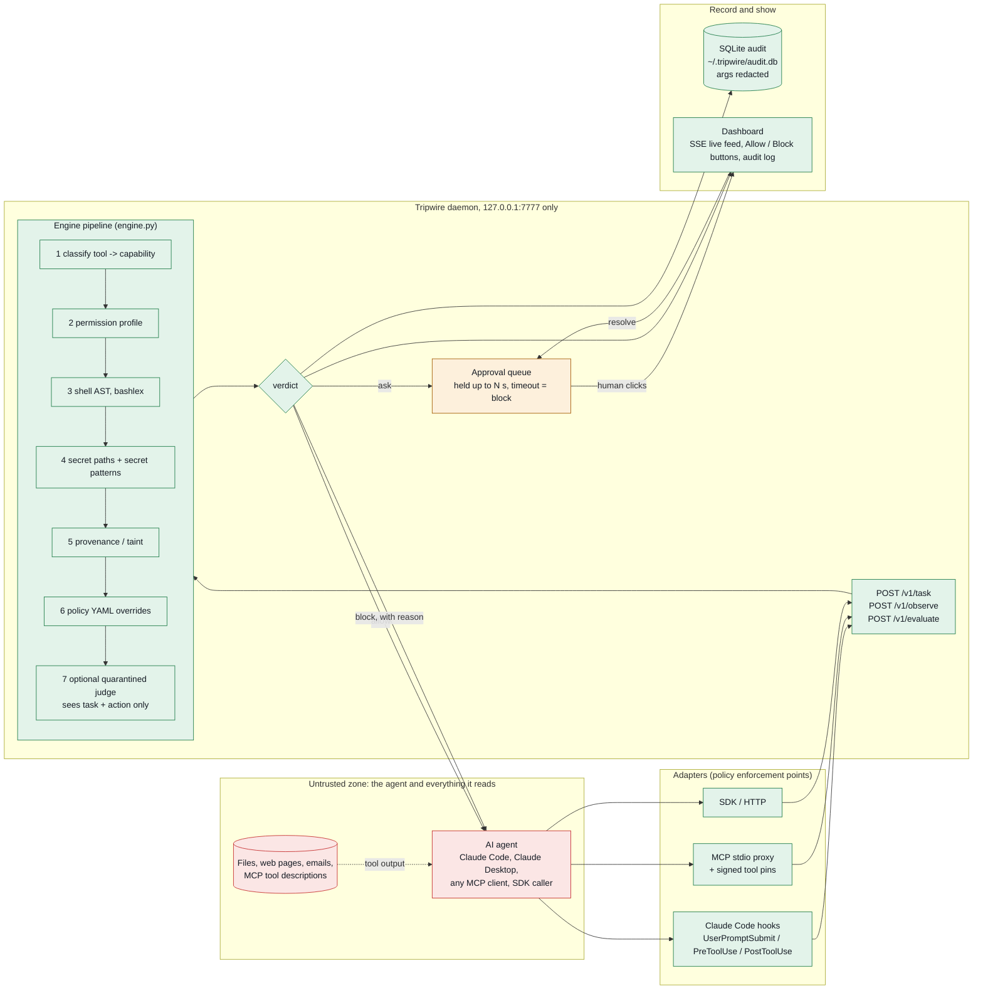

# Tripwire architecture

One sentence: every tool call an agent wants to make goes to a local daemon, which answers allow, ask or block with a reason, and the adapter refuses to run anything else.

## The picture



The red box is untrusted. Everything the agent reads, and the agent itself once it has read it, may be under the attacker's control. Everything green is Tripwire. The attacker can only send it *data*: a tool name, arguments, and tool output. None of that is ever treated as instructions.

### ASCII fallback

```
 UNTRUSTED ZONE                              TRUST BOUNDARY            TRIPWIRE (trusted, local)
 ------------------------------------------- || ----------------------------------------------------------
                                             ||
  files, web pages, emails,                  ||
  MCP tool descriptions                      ||
        |  tool output (data)                ||
        v                                    ||
  +-------------+   tool call     +----------++----------+   POST /v1/evaluate   +-----------------------+
  |  AI agent   | --------------> | adapter (enforcement) | --------------------> | daemon 127.0.0.1:7777 |
  | Claude Code |                 |  . Claude Code hooks  |                       |                       |
  | MCP client  | <-------------- |  . MCP proxy + pins   | <-------------------- |  engine pipeline      |
  | SDK caller  |  allow / block  |  . SDK / HTTP         |   verdict + reason    |  1 classify           |
  +-------------+  with reason    +-----------------------+                       |  2 permission profile |
        ^                               |                                         |  3 shell AST          |
        |  user prompt -----------------+--> POST /v1/task   (the ONLY trusted text) 4 secret paths/pats  |
        |  tool output ------------------> POST /v1/observe  (untrusted, tainted)  |  5 provenance (taint) |
        |                                                                         |  6 policy YAML        |
   if the daemon is down or the                                                   |  7 judge (optional,   |
   adapter crashes: DENY (fail closed)                                            |    never sees output) |
                                                                                  +-----------+-----------+
                                                                                              |
                                                                 +----------------------------+-----------------+
                                                                 |                            |                 |
                                                              allow                          ask              block
                                                                 |                            |                 |
                                                                 |                 +----------v---------+       |
                                                                 |                 | approval queue     |       |
                                                                 |                 | human: Allow/Block |       |
                                                                 |                 | timeout -> block   |       |
                                                                 |                 +----------+---------+       |
                                                                 |                            |                 |
                                                                 +------------+---------------+-----------------+
                                                                              v
                                                      +-----------------------+-----------------------+
                                                      | SQLite audit ~/.tripwire/audit.db (redacted)  |
                                                      | Dashboard: SSE live feed, evidence, audit log |
                                                      +-----------------------------------------------+
```

## The trust boundary

Three kinds of input reach the daemon. Only one is trusted.

| Input | Endpoint | Trust | What happens to it |
|---|---|---|---|
| The user's prompt | `POST /v1/task` | trusted | Added to `TaintStore.trusted`. Values here (addresses, URLs, commands) are "yours". |
| Tool output | `POST /v1/observe` | untrusted | Scanned for URLs, emails, IBANs, UPI ids, IPs, phones, domains and command lines. Each is recorded with its source. Scanned for hidden-instruction markers. Never parsed as instructions. |
| A proposed tool call | `POST /v1/evaluate` | untrusted | Judged. Its arguments are compared against the two stores above. |

The engine never asks "does this text look like an instruction and should I follow it". It asks "did this value come from the user, or from something the agent read". That question has a deterministic answer.

The optional judge (`tripwire serve --judge`, `judge.py`, a local Ollama model, default `qwen2.5:3b`) is kept behind the same boundary: it receives the task, the profile name, the redacted action and the deterministic findings' rule ids and messages, and nothing from any observation or evidence snippet. Arguments are the one place attacker text could still enter, so every string is truncated and fenced in a data block tagged with a random per-call marker. Its answer can only move an ASK to block, or to allow with confidence 0.8 or more and never when hidden instructions, money, a login change or a role-level ask is involved. Malformed output, timeout or Ollama down keeps the ASK.

## The pipeline, step by step

All in `src/tripwire/engine.py`. One `Action` in, one `Verdict` out, about 0.03 ms median.

1. **Classify** (`classify.py`). Tool name to capability: read, fetch, write, exec, send, money, delete, credential, agent, unknown. Exact names for Claude Code built-ins, then verb rules, then keyword patterns. `mcp__server__tool` names are normalised. Policy YAML can override any tool. Unknown is a medium finding: a human decides.
2. **Permission profile** (`policy.py`, `default_policy.yaml`). A role is three lists: allow, ask, deny, each of tool globs or `cap:<capability>`. Deny beats ask beats allow. A tool in none of the lists is "outside" the role and blocked. Three roles ship: coding-assistant, inbox-assistant, finance-assistant.
3. **Shell AST** (`analyzers/shell.py`). bashlex parses the command. Rules run per command, per pipeline and per script. Command substitutions, `bash -c`, `eval`, `python -c`, heredocs, base64 and hex payloads are decoded and analyzed recursively, up to depth 6. A parse failure is itself a finding.
4. **Paths and secrets** (`analyzers/paths.py`, `analyzers/secrets.py`). Credential paths need approval to read; writes to persistence files (`.zshrc`, cron, git hooks, `.claude/settings.json`) are blocked; secret material in outgoing arguments is blocked; a secret read followed by any send or fetch is flagged as exfiltration.
5. **Provenance** (`taint.py`). Outgoing values (send, money, fetch, exec) are checked against the untrusted store. A value from content that also carried hidden instructions is attacker-chosen: critical. A value from a clean document the user pointed at, for an action the user asked for: low, "check the details". A command copied verbatim from a file is flagged if it is risky or unfamiliar after an injection; "run npm test" from a README is fine.
6. **Policy YAML** (`policy.py`). First matching rule wins and overrides the score. Load order: built-in, `~/.tripwire/policy.yaml`, `./.tripwire.yaml`. Built-in rule: no write may touch `.tripwire`, the hook command or `.claude/settings.json`.
7. **Score and decide**. Risk is the highest finding severity plus 5 per extra high finding. 80 or more blocks, 50 or more asks. Money always asks at least.

Any exception anywhere in `evaluate()` produces a block verdict with `engine.error`. The guard cannot fail open from a bug.

## Adapters

**Claude Code hooks** (`adapters/claude_code.py`, `tripwire install claude`). Three hooks: `UserPromptSubmit` sends the prompt as the trusted task, `PreToolUse` evaluates and maps block to `deny`, ask to `ask`, allow to no decision (Claude Code's own permissions still apply), `PostToolUse` sends the output as untrusted. Stdlib only, 2 s HTTP timeout. Every failure path on `PreToolUse` ends in an explicit deny; the last-resort handler exits 2, which Claude Code treats as a hard block.

**MCP stdio proxy** (`adapters/mcp_proxy.py`, `tripwire mcp-proxy --name X --profile Y -- <server cmd>`). Sits between any MCP client and server. `tools/call` is evaluated first, with the call held up to 120 s for a human. Anything but allow is answered by the proxy with an `isError` result; the server never sees it. Tool results are recorded as untrusted before the client sees them. `tools/list` goes through the pins.

**Signed tool pins** (`adapters/pins.py`). Each tool is hashed (SHA-256 over name, description, inputSchema). Hashes are pinned per server in `~/.tripwire/tool_pins.json`, HMAC-signed with a key created once at `~/.tripwire/pin.key` (mode 0600). First sight pins (trust on first use). A changed or new tool is hidden and its calls blocked until `tripwire pins approve <server>`. A description with hidden-instruction markers or invisible characters is hidden forever. A pin file that fails its signature makes every tool unverified.

**SDK / HTTP**. Any program can call the three endpoints directly. `demo/run_demo.py` does this.

## Daemon and storage

`server.py`, FastAPI on uvicorn, bound to 127.0.0.1 only. No auth because nothing off the machine can reach it.

- `POST /v1/evaluate?wait=N` holds an ASK up to N seconds (max 300) for a human answer; timeout resolves to block.
- `POST /v1/verdicts/{id}/resolve` is what the dashboard buttons call.
- `GET /v1/events` streams task, observe, verdict, held, resolved and reset events over SSE.
- `GET /v1/audit` reads the SQLite log. Every verdict is written, including how an ASK was resolved and by whom (human or timeout).
- Arguments are redacted with `secrets.redact` before they are stored or broadcast, so a leaked key in a blocked call does not end up in the audit log.

The dashboard (`static/`, plain HTML and JS, no build step) shows a live feed per session, an approval queue with Allow and Block, an evidence panel that quotes the untrusted snippet a verdict was based on, and the audit log.

## What the attacker cannot do

- Talk the engine out of a decision. No component that reads untrusted text makes a decision.
- Edit the guard through the agent. Writes to its config and the hook settings are blocked by policy.
- Wait for the guard to go down. Down means deny.
- Swap a tool's description after approval. The pin changes, the tool is hidden.
- Hide a payload in base64, hex, `$IFS`, homoglyphs or `bash -c`. The shell analyzer decodes and re-analyzes.

What the attacker can still do is listed in `demo/THREAT_MODEL.md`, "What Tripwire does not defend".
