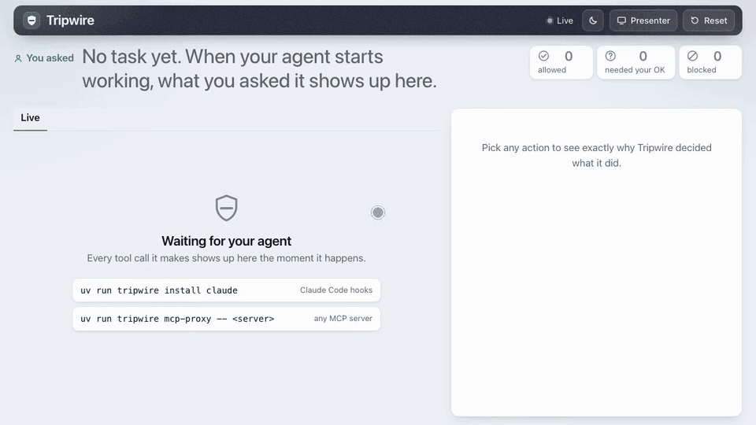

# Presenting Tripwire

The full talk track is `demo/SCRIPT.md`. This page is the stage kit around it.



## Two commands before you go on

```
scripts/preflight.sh     # green/red checklist, about 15 s
scripts/stage.sh         # clean daemon, reset, dashboard in presenter mode, prints the next commands
```

`preflight.sh` checks: uv env synced, daemon healthy and really Tripwire on the port (or the port is free),
dashboard and its assets load, a fast test subset (engine, adapters, shell), all five demo scenarios pass
both acts offline, the backup video exists, Ollama (optional), and AC power. It only reminds you about
Do Not Disturb and fonts. It never changes a system setting.

`stage.sh` restarts the daemon with `scripts/restart_daemon.sh`, resets it, empties the attacker's inbox,
opens `http://127.0.0.1:7777/?stage=1&theme=light`, and prints the exact commands for Act 1, Act 2,
beyond-permission and the proof. Both take a port: `scripts/stage.sh 7778`. `NO_OPEN=1` skips the browser.

## Backup video

If the live demo breaks, play these. They were recorded from the real code, not mocked.

| File | What |
|---|---|
| `demo-video/tripwire-demo.mp4` / `.webm` | Dashboard, presenter mode, 1280x720, about 1 min. Act 2 injected-doc with real clicks (Block the SSH key, Allow .env twice, the email to the attacker is blocked anyway), then beyond-permission (Allow saving the summary; the $4,900 wire and the command are blocked). |
| `demo-video/tripwire-terminal.mp4` / `.webm` | The terminal story, about 1 min: Act 1 (attack lands, attacker's inbox fills), Act 2 (inbox stays empty), beyond-permission. Replayed with real timing from captured output. |
| `demo-video/tripwire-demo.gif` | Small loop of the dashboard clip for this page. |
| `demo-video/tripwire-dashboard.png`, `tripwire-terminal.png` | Stills. |

Re-record after any dashboard or engine change (about 3 minutes):

```
uv run --with playwright playwright install chromium        # once
uv run --with playwright --with imageio-ffmpeg python scripts/record_demo.py
```

It runs its own daemon on port 7792 with a throwaway HOME, so your real `~/.tripwire/audit.db` is never
touched. Playwright and imageio-ffmpeg (a pip-packaged ffmpeg) are used only for recording; they are not
Tripwire dependencies.
